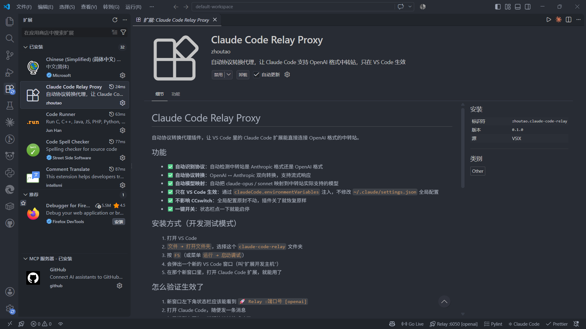
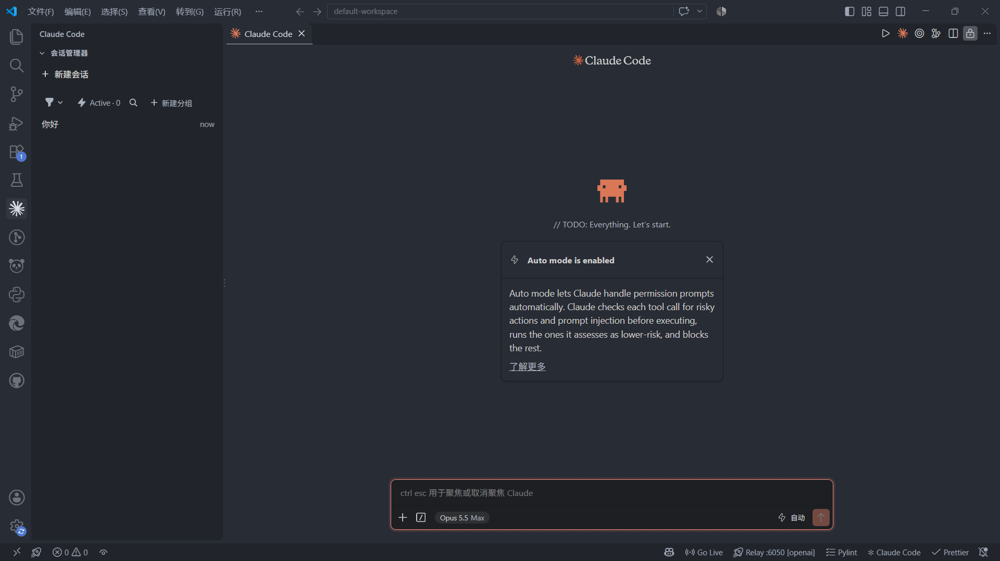

# Claude Code Relay Proxy

> 让 VS Code 里的 Claude Code 扩展能直接连 OpenAI 格式的中转站 —— 一个本地协议转换代理。

[](LICENSE)
[](https://code.visualstudio.com/)
[](CHANGELOG.md)
[](package.json)

一个 VS Code 扩展。它在本地起一个 HTTP 服务，把 Claude Code 发出来的 **Anthropic Messages API** 请求，实时翻译成 **OpenAI Chat Completions API**，再把响应翻译回来 —— 包括流式 SSE。

<!-- 介绍页面 -->


---

## 它解决什么问题

Claude Code 扩展只会说 Anthropic 协议（`POST /v1/messages`）。而市面上大量中转站、聚合 API、自建网关只提供 OpenAI 协议（`POST /v1/chat/completions`）。两边对不上，你就没法在 Claude Code 里用便宜的模型。

常见的粗暴解法是把 `ANTHROPIC_BASE_URL` 全局改掉，但那样会污染 `~/.claude/settings.json`，CCswitch 之类的配置切换工具也跟着乱掉。

这个插件的做法是：**只劫持 VS Code 里的那一个进程，全局配置一个字节都不动。**

```
Claude Code 扩展
     │  Anthropic 格式  POST /v1/messages
     ▼
127.0.0.1:<随机端口>          ← 本插件
     │  自动探测上游协议
     │  OpenAI 站 → 翻译成 /v1/chat/completions
     ▼
你的中转站
```

---

## 功能

| | |
|---|---|
| 🔍 **自动识别协议** | 启动时探测上游到底是 Anthropic 站还是 OpenAI 站，探测失败默认按 OpenAI 处理（更常见） |
| 🔄 **双向协议转换** | 请求 Anthropic→OpenAI，响应 OpenAI→Anthropic，**流式 SSE 逐块转换** |
| 🎯 **自动模型映射** | 把 `claude-opus-5-5` 这类名字自动映射到上游真实存在的模型（优先 deepseek，其次 gemini） |
| 🧩 **伪造模型列表** | OpenAI 站本来没有 Claude 模型，插件给 Claude Code 返回一份假的 `/v1/models`，让模型选择器能正常工作 |
| 🪟 **只在 VS Code 生效** | 通过 `claudeCode.environmentVariables` 注入，**不碰** `~/.claude/settings.json` |
| 🔁 **可回滚** | 扩展停用 / 关闭代理时自动还原原始环境变量 |
| 🚦 **状态栏一键开关** | 右下角显示 `🚀 Relay :端口 [openai]`，点一下就能启停 |
| 📦 **零依赖** | 只用 Node 内置的 `http`/`https`/`url`/`fs`/`path`，没有 `node_modules` |

<!-- 对话页 -->


---

## 安装

### 方式一：装 VSIX（推荐）

从 [Releases](https://github.com/siyu0209/claude-code-relay-proxy/releases) 下载 `claude-code-relay-0.1.0.vsix`，然后：

```bash
code --install-extension claude-code-relay-0.1.0.vsix
```

也可以在 VS Code 里：`扩展` 面板右上角 `...` → `从 VSIX 安装...` → 选中文件。

### 方式二：源码调试模式

```bash
git clone https://github.com/siyu0209/claude-code-relay-proxy.git
cd claude-code-relay-proxy
code .
```

然后在 VS Code 里按 **F5**（或 `运行 → 启动调试`），会弹出一个新的「扩展开发主机」窗口 —— 在那个窗口里打开 Claude Code 即可。

### 验证生效

1. 新窗口左下角状态栏出现 `🚀 Relay :<端口> [openai]`
2. 打开 Claude Code，随便发一句话
3. 有回复 = 协议转换通了

---

## 配置

在设置里搜 `Claude Code Relay`：

| 配置项 | 类型 | 默认 | 说明 |
|---|---|---|---|
| `claudeCodeRelay.enabled` | boolean | `true` | 是否启用代理 |
| `claudeCodeRelay.targetBaseUrl` | string | 空 | 中转站地址。**留空则自动从 `~/.claude/settings.json` 的 `env.ANTHROPIC_BASE_URL` 读取** |
| `claudeCodeRelay.targetApiKey` | string | 空 | 中转站 Key。留空则读 `env.ANTHROPIC_AUTH_TOKEN` 或 `env.ANTHROPIC_API_KEY` |
| `claudeCodeRelay.port` | number | `0` | 本地端口，`0` = 自动分配空闲端口 |
| `claudeCodeRelay.modelMapping` | object | `{}` | 手动模型映射，如 `{"claude-opus-5-5": "x-deepseek-v4.1-flash"}`。留空则自动匹配 |

自定义示例（`settings.json`）：

```json
{
  "claudeCodeRelay.targetBaseUrl": "https://your-relay.example.com/v1",
  "claudeCodeRelay.targetApiKey": "sk-xxxxxxxx",
  "claudeCodeRelay.modelMapping": {
    "claude-opus-5-5": "your-model-name",
    "claude-sonnet-5-5": "your-model-name"
  }
}
```

### 命令

`Ctrl+Shift+P` 输入 `Claude Code Relay`：

- `Claude Code Relay: 开关代理`
- `Claude Code Relay: 配置中转站`
- `Claude Code Relay: 重新检测协议`（换了中转站之后用这个）
- `Claude Code Relay: 查看状态`（端口 / 协议 / 可用模型 / 映射表）

---

## 协议转换细节

### 请求：Anthropic → OpenAI

| Anthropic | OpenAI | 处理方式 |
|---|---|---|
| `system`（字符串或块数组） | `messages[0].role="system"` | 数组会被 `JSON.stringify` |
| `messages[].content` 字符串 | 原样 | — |
| `messages[].content` 块数组 | 拼接文本 | **只取 `type=="text"` 的块** |
| `max_tokens` | `max_tokens = max(原值 × 2, 2048)` | 给思考模型留余量，避免思考把额度吃光导致正文为空 |
| `temperature` / `top_p` / `stop_sequences` | 同名 / `stop` | 存在才转发 |

### 响应：OpenAI → Anthropic（非流式）

`choices[0].message.content` → 单个 `text` 块；`usage.prompt_tokens/completion_tokens` → `input_tokens/output_tokens`。

### 响应：流式 SSE

OpenAI 的每个 `data: {...}` 分片被转换成标准 Anthropic 事件序列：

```
message_start → content_block_start → content_block_delta* 
              → content_block_stop → message_delta → message_stop
```

上游返回 `[DONE]` 或流结束时补全收尾事件；即使上游一个字都没吐，也会发完整事件序列，避免 Claude Code 卡住。

`finish_reason` 映射：

| OpenAI | Anthropic |
|---|---|
| `stop` | `end_turn` |
| `length` | `max_tokens` |
| `content_filter` | `end_turn` |
| `tool_calls` | `tool_use` |

### 协议探测逻辑

1. `GET {baseUrl}/models`（同时带 `Authorization: Bearer` 和 `x-api-key`，两种站都试）
2. `POST {baseUrl}/messages`，`max_tokens: 1`
   - 状态码 `200` / `401` / `403` → 判定为 **anthropic**（401/403 说明端点存在，只是鉴权没通过）
   - 其他 → 判定为 **openai**
3. 拿不到模型列表或探测异常 → 默认 **openai**

---

## 已知限制

这个项目是 0.1.0，功能面窄，以下都是实话：

- **只转换文本**。`image`、`tool_use`、`tool_result` 块不会转换成 OpenAI 的 `image_url` / `tool_calls`，会被丢掉。所以**工具调用（tool use）和图片输入在 OpenAI 站上不工作**。
- **`max_tokens` 是盲目放大的**（×2）。上游如果对上限敏感，可能直接报错。
- **token 数是估算的**：流式输出按「4 字符 ≈ 1 token」累加，`message_start` 里的 `input_tokens` 恒为 0。
- **不做重试、不做断线续传**。上游 5xx 会原样变成一条 `upstream_error` 返回。
- **超时固定 300 秒**（`proxyReq.setTimeout(300000)`），硬编码，不可配。
- **模型映射只覆盖名单内的名字**（`claude-opus-5-5`、`claude-sonnet-5-5`、`claude-haiku-5-5` 及几个 `claude-3-*`）。名单外的模型名会**原样透传**，上游不认识就 404 —— 这种情况请手配 `modelMapping`。
- **日志会落盘**：所有进来的请求和请求体前 1000 字符会追加写入 `src/relay-debug.log`，用于排错。**日志里可能包含你的对话内容**，分享日志前请自己看一眼。

---

## 隐私

- 代理只监听 `127.0.0.1`，不对外暴露端口。
- 除了你配置的中转站，不向任何第三方发请求 —— 没有遥测、没有统计、没有云同步。
- `targetApiKey` 以明文存在 VS Code 的 `settings.json` 里（VS Code 扩展配置没有加密存储机制），**别把这份 settings 提交到公开仓库**。

## 免责声明

本插件只做协议格式转换，不提供、不代理、不转售任何模型服务。你需要自己准备上游 API 与合法凭据。使用第三方中转服务产生的一切后果（可用性、计费、数据合规、服务条款）与本项目无关。

## 目录结构

```
.
├── src/
│   ├── extension.js      # 扩展入口：状态栏、命令、环境变量注入与还原
│   ├── proxy.js          # 本地 HTTP 服务：协议探测、透传、转发、日志
│   └── transformer.js    # 协议转换器：请求/响应/流式 SSE 三套转换
├── docs/screenshots/     # 截图
├── icon.png              # 扩展图标
├── package.json          # 扩展清单（命令、配置项、入口）
└── .vscode/launch.json   # F5 调试配置
```

三个源文件共约 27 KB，没有构建步骤，改完直接 F5。

## License

[MIT](LICENSE) © 2026 zhoutao

---

## English

**Claude Code Relay Proxy** is a VS Code extension that runs a local HTTP proxy translating Anthropic Messages API ↔ OpenAI Chat Completions API on the fly, including streaming SSE. It injects `ANTHROPIC_BASE_URL` via `claudeCode.environmentVariables` so **only the Claude Code extension inside VS Code** is affected — your global `~/.claude/settings.json` stays untouched and is restored when the extension deactivates.

- Auto-detects whether the upstream speaks Anthropic or OpenAI, falling back to OpenAI.
- Auto-maps Claude model names to models the upstream actually has (deepseek → gemini → first available).
- Serves a synthetic `/v1/models` list so Claude Code's model picker keeps working.
- Zero npm dependencies — Node built-ins only.

Limitations: text-only. Image blocks and tool use / tool results are **not** converted. Token counts in streamed responses are estimated. Logs (including up to 1000 chars of each request body) are written to `src/relay-debug.log`.

Install: download the `.vsix` from [Releases](https://github.com/siyu0209/claude-code-relay-proxy/releases) and run `code --install-extension claude-code-relay-0.1.0.vsix`.

MIT licensed.
